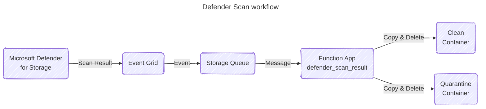

# Defender Scan — Process and route malware scan results

## Purpose

The Defender Scan Function App processes malware scan results from Microsoft Defender for Storage and automatically routes scanned blobs to clean or quarantine storage containers based on the scan verdict.

## What it does

When a file uploaded to Azure Storage is scanned by Microsoft Defender for Storage, a scan result event is published to Event Grid. This function:

1. **Receives** malware scan result events from Event Grid via an Azure Storage Queue
2. **Parses** the scan verdict (Malicious, Clean, or other)
3. **Routes** the scanned blob to the appropriate destination:
   - **Clean blobs** → copied to the clean container
   - **Malicious blobs** → copied to the quarantine container
4. **Cleans up** by deleting the source blob after a successful move

This workflow ensures that potentially dangerous files are isolated from legitimate data, improving security posture and audit compliance.

## High-level architecture

## How it works

### Event flow

1. **Scan trigger**: A blob is uploaded to a monitored storage account. Microsoft Defender for Storage automatically scans it for malware.
2. **Result delivery**: Defender publishes the scan result (verdict + blob metadata) to Event Grid.
3. **Queue ingestion**: Event Grid routes the result event to a Storage Queue configured with `none` encoding.
4. **Function processing**: The Function App polls the queue and processes messages.

### Blob routing logic

When the function receives a scan result event:

1. **Validates** the event type is a Malware Scanning Result (`Microsoft.Security.MalwareScanningResult`)
2. **Extracts** key metadata from the event:
   - Scan verdict (`scanResultType`)
   - Source blob URI (`blobUri`)
   - Blob ETag (`eTag`)
3. **Routes** based on verdict:
   - `Malicious`: moves blob to the quarantine container
   - `No threats found`: moves blob to the clean container
   - Other: logs the verdict and takes no action
4. **Moves** the blob by copying and then deleting:
   - Downloads the blob from the source storage account
   - Uploads it to the destination container with a qualified name (`{source_account}/{source_container}/{blob_name}`)
   - Deletes the source blob after the upload completes
   - Uses ETags on both download and delete operations to ensure the blob wasn't modified between scan and move

### Security considerations

- **ETag verification**: The function checks that the blob hasn't been modified since the scan by verifying the ETag on download and deletion. If the blob changed, it is left in place and an error is logged.
- **VNet isolation**: The Function App uses VNet integration with a dedicated subnet that has a Microsoft.Storage service endpoint, allowing it to reach restricted storage accounts.
- **Managed identities**: Authentication uses Entra ID identities with scoped roles (Event Grid and Storage), avoiding shared keys and improving audit trails.
- **Firewall compliance**: Storage firewall rules allow the Function App subnet to access monitored storage accounts while blocking other access.

## Configuration

The function requires these Azure app settings:

| Setting | Description | Example |
| --- | --- | --- |
| `DEFENDER_STORAGE_ACCOUNT_NAME` | Destination storage account where clean and quarantine containers reside | `mydefenderaccount` |
| `CLEAN_CONTAINER_NAME` | Container name for clean blobs | `clean` |
| `QUARANTINE_CONTAINER_NAME` | Container name for malicious blobs | `quarantine` |
| `DEFENDER_SCAN_RESULTS_QUEUE` | Storage Queue name where Event Grid delivers scan results | `defender-scan-results` |
| `AzureWebJobsStorage` | Connection string for the queue-triggered function runtime | *(set by Azure Functions)* |

## Error handling

The function handles various error scenarios:

- **Missing event metadata**: If `scanResultType`, `blobUri`, or `eTag` are missing, an error is logged and processing stops.
- **Unsupported event types**: Events that are not Malware Scanning Results are logged and skipped.
- **Modified blobs**: If a blob changes between scan and move (ETag mismatch), it is left in the source container and a warning is logged.
- **Missing source blob**: If the source blob no longer exists, an error is logged and processing stops.

## Related infrastructure

- **Terraform**: See [defender.tf](../../infrastructure/terraform/defender.tf) and [defenderscan.tf](../../infrastructure/terraform/defenderscan.tf) for infrastructure as code definitions.
- **Documentation**: See [Infrastructure Guide](../../infrastructure/README.md#defender-scan-workflow) for the complete deployment workflow.
